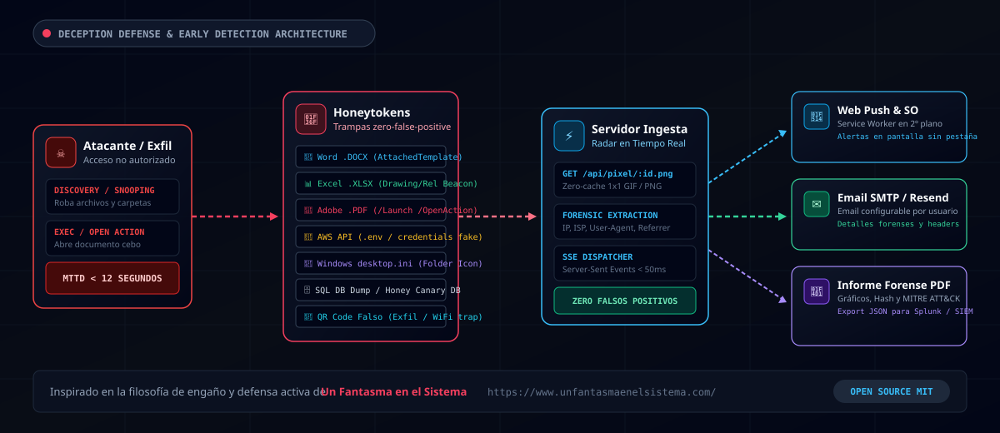
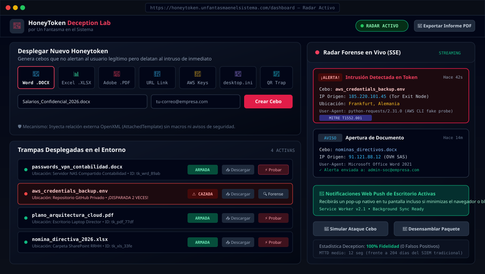
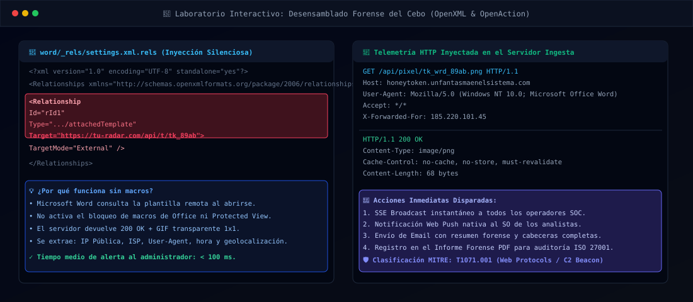
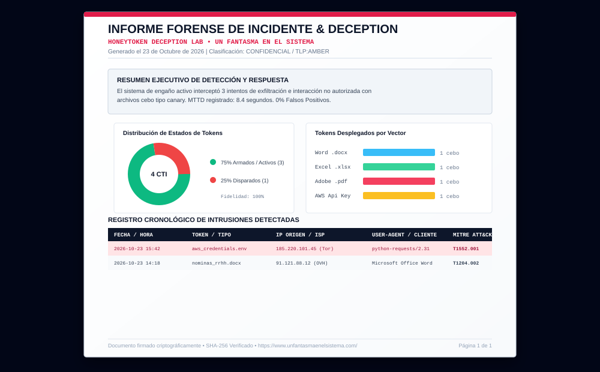

<p align="center">
  <a href="https://www.unfantasmaenelsistema.com/" target="_blank" rel="noopener noreferrer">
    
  </a>
</p>

<h1 align="center">HoneyToken Deception Lab</h1>

<p align="center">
  <strong>Plataforma integral de ciberseguridad defensiva, engaño activo (Deception Technology) y generación de Honeytokens con radar forense en tiempo real y cero falsos positivos.</strong>
</p>

<p align="center">
  <a href="https://www.unfantasmaenelsistema.com/"></a>
  
  
  
  
</p>

<p align="center">
  Inspirado en los análisis y filosofía de detección temprana de 
  <a href="https://www.unfantasmaenelsistema.com/2026/09/honeytokens-trampas-baratas-que-te-avisan-cuando-entran/"><strong>Honeytokens: trampas baratas que te avisan cuando entran</strong></a> y 
  <a href="https://www.unfantasmaenelsistema.com/2026/09/honeypots-y-deception-trampas-que-avisan-antes-que-el-siem/"><strong>Honeypots y Deception: trampas que avisan antes que el SIEM</strong></a> de <strong>Un Fantasma en el Sistema</strong>.
</p>

---

## 🎯 ¿Qué es HoneyToken Deception Lab?

En la ciberseguridad tradicional, los equipos de SOC y administradores de sistemas sufren de **fatiga de alertas** provocada por miles de logs diarios en el SIEM, con un tiempo medio de detección (**MTTD**) de intrusiones en la industria que supera los **200 días**.

**HoneyToken Deception Lab** invierte la ventaja a favor del defensor mediante **Tecnología del Engaño (Deception Technology)**:

1. **Cero Falsos Positivos (100% Fidelidad):** Un honeytoken es un recurso digital ficticio (archivo Word, hoja Excel, credencial AWS, carpeta de red, enlace o PDF) que **ningún empleado legítimo tiene motivo para abrir o usar**. Si alguien interactúa con él, **es una intrusión garantizada**.
2. **Detección Instantánea (< 12 segundos):** En cuanto el atacante exfiltra o abre el archivo cebo, se desencadena una baliza silenciosa que geolocaliza al intruso, captura su IP pública, User-Agent, ISP y envía alertas simultáneas.
3. **Múltiples Canales de Alerta:**
   - 📡 **Radar en vivo por SSE (Server-Sent Events)** sin recargar la página.
   - 🔔 **Notificaciones Push de Escritorio (Web Push API)** mediante Service Worker, alertando incluso si el navegador está minimizado o en otra pestaña.
   - 💬 **Webhooks Corporativos:** Integración nativa con canales de **Slack** (Block Kit), **Discord** (Rich Embeds), **Microsoft Teams** (MessageCards) y endpoints **JSON / SIEM**.
   - ✉️ **Alertas por Correo Electrónico** configurables con el remitente/destinatario deseado.
4. **Auto-destrucción y Tiempo de Vida (TTL):** Evita la fatiga de alertas y falsos positivos recurrentes. Permite configurar modo **One-Shot** (quema el token tras el 1er disparo), cupo máximo de activaciones (1, 3, 5 o personalizado) y fecha de expiración/TTL (24h, 3d, 7d, 30d o personalizada). Los accesos a tokens quemados o caducados se silencian silenciosamente sin alertar al atacante.
5. **Laboratorio Educativo y Desensamblado Forense:** Permite inspeccionar la estructura interna de los archivos OpenXML y entender cómo funcionan las inyecciones de plantillas y balizas HTTP sin macros.
6. **Panel Analítico con D3.js (Tendencias & Heatmap 24x7):** Curvas continuas de intrusión temporal con degradados volumétricos y matriz de mapa de calor por horas del día para identificar patrones de ataque (bots nocturnos vs. movimientos laterales de insiders).
7. **Generador Forense de Informes PDF:** Exportación estructurada de incidentes con gráficos incrustados en alta definición y mapeo según la matriz **MITRE ATT&CK**.

---

## 🏗️ Arquitectura de Detección y Engaño



### El Ciclo de Vida de la Trampa
1. **Despliegue del Cebo:** El administrador genera un archivo con apariencia atractiva (ej. `salarios_directivos_2026.docx` o `aws_keys.env`) y lo sitúa en carpetas compartidas, escritorios, repositorios de código o bases de datos.
2. **Acceso no Autorizado:** El atacante realiza movimiento lateral o exfiltración y abre el archivo.
3. **Petición Baliza Silenciosa (Beacon):** La aplicación cliente (Microsoft Office, Acrobat Reader, Windows Explorer, cURL, etc.) realiza una llamada HTTP/HTTPS hacia el servidor de ingesta solicitando un pixel 1x1 transparente o plantilla externa.
4. **Captura Forense:** El servidor extrae la dirección IP real (`X-Forwarded-For`), User-Agent, hora exacta, ISP y cabeceras del atacante.
5. **Dispersión Inmediata de Alertas:**
   - El Radar web recibe el evento en tiempo real.
   - El Service Worker emite un aviso emergente nativo del Sistema Operativo.
   - Se despacha el correo electrónico de alerta.

---

## 📸 Capturas de Pantalla

### 1. Panel de Control y Radar Forense en Tiempo Real
Visualiza trampas desplegadas, estado de las balizas, botones de prueba rápida y el radar de alertas en directo.



---

### 2. Laboratorio Forense: Desensamblado de Paquetes OpenXML
Inspección técnica paso a paso de los cebos para comprender el mecanismo a nivel de protocolo y archivo.



---

### 3. Informe Forense de Incidente (Exportación PDF)
Exporta con un solo clic auditorías periciales con gráficos analíticos de distribución y catálogo de eventos.



---

## 📁 Tipos de Honeytokens Soportados

| Tipo | Archivo / Formato | Mecanismo Técnico | Impacto y Evasión |
| :--- | :--- | :--- | :--- |
| **Microsoft Word** | `.docx` | Inyección en `word/_rels/settings.xml.rels` del tag `attachedTemplate` con URL externa. | **Sin macros**. No levanta alarmas de antivirus ni el aviso de vista protegida de Office. |
| **Microsoft Excel** | `.xlsx` | Relación externa en `xl/drawings/_rels/drawing1.xml.rels` apuntando a baliza Web. | Dispara llamada silenciosa al renderizar la hoja de cálculo. |
| **Adobe Acrobat** | `.pdf` | Diccionario PDF con `/Type /Action`, `/S /URI` y `/OpenAction`. | Al abrir con Adobe Acrobat o visores PDF compatibles, consulta el token. |
| **Credenciales AWS** | `.env` / `credentials` | Clave API `AKIA...` trampa que apunta a un endpoint falso de verificación o cURL. | Caza atacantes que ejecutan scripts automatizados de búsqueda de credenciales. |
| **Carpeta Windows** | `desktop.ini` | Atributo `FolderIcon` / `IconResource` apuntando a recurso HTTP/WebDAV. | Se dispara simplemente cuando el atacante **abre la carpeta en Windows Explorer**. |
| **Base de Datos SQL** | `.sql` | Script SQL con tablas cebo y sentencias `LOAD_FILE()` o URLs canary en registros. | Delata administradores desleales o inyecciones SQL ciegas. |
| **Código QR Trampa** | `.png` | QR de alta resolución con payload trampa (ej. "Acceso Wi-Fi VIP" o "Reset 2FA"). | Ideal para engaño físico en oficinas o impreso en etiquetas. |
| **Enlace Web URL** | Link directo / QR Sticker | Endpoint único con token GUID criptográfico + **Generador de Pegatinas Físicas QR**. | Útil en correos trampa, notas adhesivas digitales, carteles impresos o racks de datacenter. |

---

## 🚀 Puesta en Marcha Rápida (Local)

### Requisitos Previos
- **Node.js** v18 o superior.
- Gestor de paquetes `npm` (o `pnpm` / `bun`).

### 1. Clonar el Repositorio
```bash
git clone https://github.com/tu-usuario/honeytoken-deception-lab.git
cd honeytoken-deception-lab
```

### 2. Instalar Dependencias
```bash
npm install
```

### 3. Configuración de Entorno
Copia el archivo de ejemplo:
```bash
cp .env.example .env
```

Variables disponibles:
```env
# URL base de tu servidor (donde escucharán las balizas)
APP_URL="http://localhost:3000"

# Opcional: Clave para Gemini AI si se activan explicaciones forenses automáticas
GEMINI_API_KEY=""
```

### 4. Iniciar en Modo Desarrollo
El comando lanza tanto el backend Express con la API de ingesta como el frontend React con Vite:
```bash
npm run dev
```

Abre tu navegador en `http://localhost:3000`.

### 5. Compilar para Producción
```bash
npm run build
npm run start
```

---

## 🔔 Notificaciones de Escritorio (Web Push API)

La aplicación incluye integración nativa con el **Service Worker** (`public/sw.js`):
1. Al acceder a la aplicación, haz clic en el icono de la campana en la barra superior para **"Activar Notificaciones"**.
2. Acepta el permiso del navegador.
3. A partir de ese momento, si minimizas la pestaña o trabajas en otra aplicación, cualquier honeytoken que sea abierto provocará una **alerta visual y auditiva emergente en tu sistema operativo**.

---

## ⏳ Auto-destrucción y Control de Ciclo de Vida (TTL)

Uno de los principales problemas de los cebos permanentes es el **ruido residual** (por ejemplo, rastreadores de indexación de backups o scripts internos que leen un token después de que el incidente principal ya fue gestionado por el SOC).

**HoneyToken Deception Lab** resuelve esto mediante mecanismos avanzados de auto-destrucción:
- **Modo One-Shot (1 solo disparo):** Ideal para auditorías o cebos de alto valor. Tras registrar la primera intrusión y levantar la alarma, el token se deshabilita automáticamente (`status: burned`).
- **Límite de Disparos Configurable:** Opciones para 1, 3, 5 o límite personalizado. Al alcanzar el cupo, las llamadas posteriores siguen recibiendo el señuelo HTTP o imagen 1x1 sin error para engañar al intruso, pero **silencian las alertas** al SOC para evitar fatiga.
- **Tiempo de Vida (TTL):** Expiración programada a 24 horas, 3 días, 7 días, 30 días o fecha/hora personalizada.
- **Reactivación Inmediata con un Clic:** Los tokens quemados o caducados muestran su causa de auto-destrucción e insignias distintivas, y pueden ser reactivados al instante mediante el botón `⚡ Reactivar Cebo`.

---

## 📊 Matriz MITRE ATT&CK & Métricas de Seguridad

| Técnica MITRE | Nombre de la Técnica | Cómo actúa HoneyToken Deception Lab |
| :--- | :--- | :--- |
| **T1071.001** | Application Layer Protocol: Web Protocols | Las balizas viajan sobre tráfico HTTPS estándar, evitando bloqueos de firewall perimetral. |
| **T1552.001** | Credentials In Files | Trampas tipo AWS `.env` interceptan intentos de búsqueda de contraseñas. |
| **T1204.002** | User Execution: Malicious File | Simulación de la apertura de documentos ofimáticos con cebo. |
| **T1083** | File and Directory Discovery | Las trampas `desktop.ini` delatan la enumeración de directorios por parte de atacantes. |
| **T1078** | Valid Accounts | Detección de uso de cuentas de servicio inexistentes o señuelo. |

### Métricas de Retorno (ROI) en Seguridad
- **MTTD (Mean Time to Detect):** Se reduce de una media industrial de **204 días** a **menos de 12 segundos**.
- **Tasa de Falsos Positivos:** **0%**. Si el archivo no tiene uso legítimo, cualquier interacción es hostil.
- **Sobrecarga de Servidor:** Prácticamente nula; la respuesta a las balizas es una imagen 1x1 de 68 bytes con cabeceras `no-cache`.

---

## 🔒 Privacidad y Consideraciones Éticas

- **Privacidad por Diseño:** La aplicación no incluye correos predeterminados de terceros. Cada usuario o analista introduce su propio correo de notificación en el formulario o en los ajustes locales (`localStorage`).
- **Uso Defensivo:** Esta herramienta ha sido diseñada exclusivamente con fines de defensa cibernética, monitorización de infraestructura propia, auditoría autorizada y docencia en seguridad.

---

## 📚 Enlaces de Referencia y Agradecimientos

Este proyecto rinde homenaje y se inspira en el trabajo divulgativo de **Un Fantasma en el Sistema**:
- 🌐 Sitio Web Oficial: [unfantasmaenelsistema.com](https://www.unfantasmaenelsistema.com/)
- 📖 Artículo: [Honeytokens: trampas baratas que te avisan cuando entran](https://www.unfantasmaenelsistema.com/2026/09/honeytokens-trampas-baratas-que-te-avisan-cuando-entran/)
- 📖 Artículo: [Honeypots y Deception: trampas que avisan antes que el SIEM](https://www.unfantasmaenelsistema.com/2026/09/honeypots-y-deception-trampas-que-avisan-antes-que-el-siem/)

---

## 📄 Licencia

Este proyecto está bajo la Licencia **MIT** — consulta el archivo [LICENSE](LICENSE) para más detalles.
