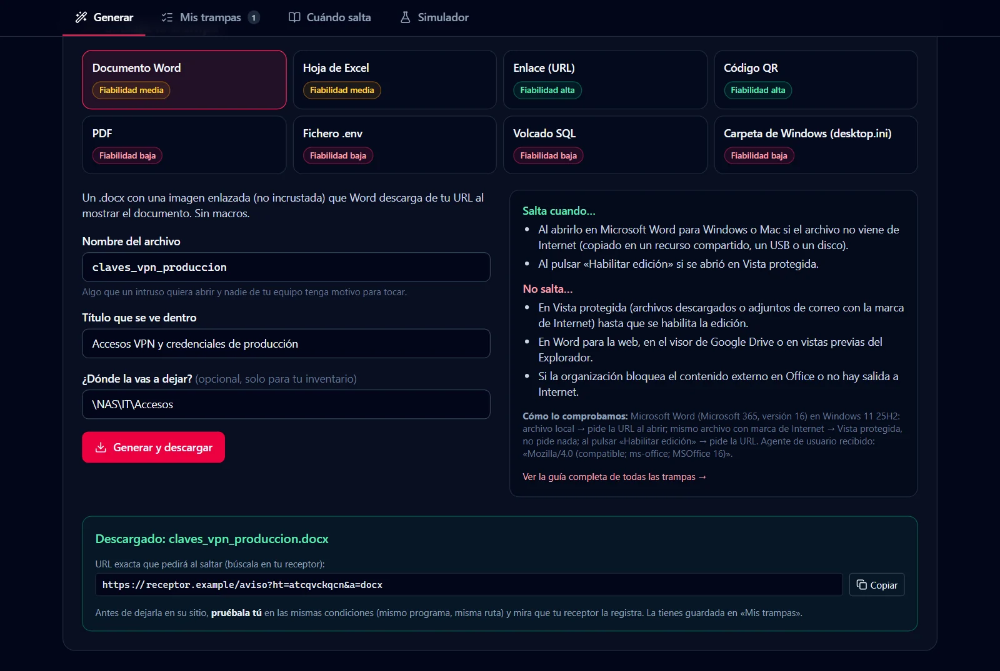
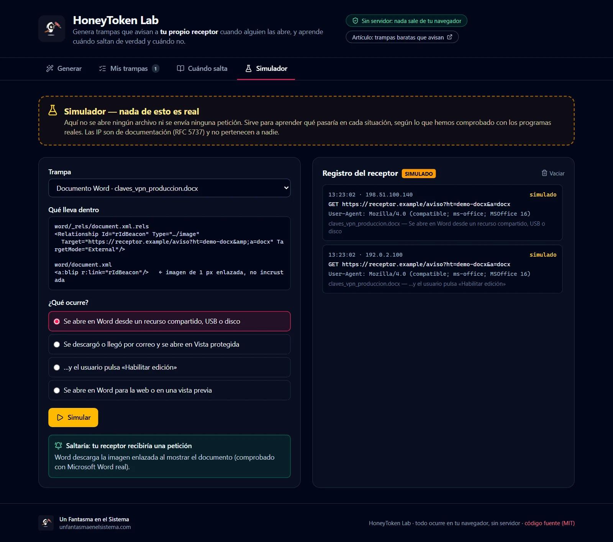
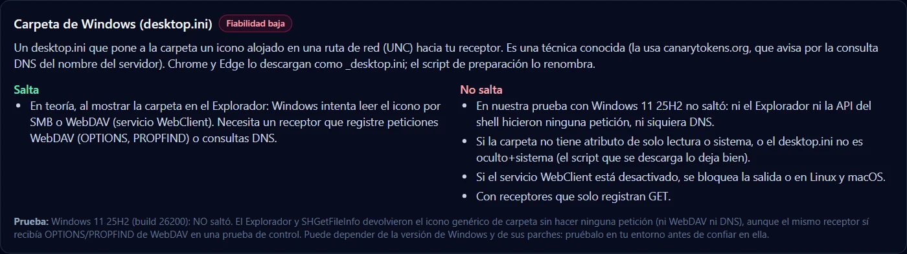

<p align="center">
  <a href="https://www.unfantasmaenelsistema.com"></a>
</p>

<h1 align="center">HoneyToken Lab</h1>

<p align="center">
  <b>Laboratorio de honeytokens en el navegador</b><br>
  Genera trampas que avisan a <i>tu</i> receptor · Aprende cuándo saltan de verdad · Simulador marcado como tal
</p>

<p align="center">
  <a href="https://unfantasmaenelsistema.github.io/HoneyTokenLab/"><b>▶ Abrir el laboratorio</b></a> ·
  <a href="#qué-hace">Qué hace</a> ·
  <a href="#comprobado-con-los-programas-reales">Comprobado con los programas reales</a> ·
  <a href="#para-clase">Para clase</a> ·
  <a href="https://www.unfantasmaenelsistema.com">unfantasmaenelsistema.com</a> ·
  <a href="LICENSE">MIT</a>
</p>

<p align="center">
  
  
  
  
</p>

<p align="center">
  
</p>

Un honeytoken es un recurso falso (un documento, un enlace, unas credenciales) que nadie de tu equipo tiene motivo para tocar. Si alguien lo abre, el programa que lo abre pide una URL y **el receptor que hay detrás de esa URL te avisa**. Este laboratorio genera esas trampas apuntando a la URL que tú elijas y te cuenta, con pruebas hechas con los programas reales, **cuándo saltan y cuándo no**.

> [!IMPORTANT]
> La app no tiene servidor y no ve nada: no recibe avisos, no manda correos y no sabe si una trampa ha saltado. Eso lo hace tu receptor (canarytokens.org, webhook.site, interactsh o un servidor tuyo). Úsalas solo en sistemas propios o con permiso, e infórmalo: la IP de quien abre la trampa es un dato personal.

## Qué hace

- **Receptor propio**: pegas la URL de tu receptor y, si quieres, se le añade `?ht=<identificador>&a=<tipo>` para saber qué trampa ha saltado. Hay un botón para probar que tu receptor la registra.
- **8 trampas**: Word (`.docx`), Excel (`.xlsx`), enlace, código QR (con pegatina imprimible), PDF, `.env` con credenciales señuelo, volcado SQL y carpeta de Windows (`desktop.ini` con su script de PowerShell para poner los atributos). Cada una muestra su **fiabilidad**, cuándo salta, cuándo no y cómo se comprobó.
- **Mis trampas**: inventario en este navegador con el identificador, la URL de aviso y dónde la dejaste. Se puede volver a descargar la misma trampa, exportar a JSON o CSV e importar.
- **Cuándo salta**: guía trampa por trampa, avisos que no son un intruso (vistas previas de enlaces, antivirus del correo, indexadores…), buenas prácticas y qué comportamientos de MITRE ATT&CK pueden delatar.
- **Simulador**: elige una trampa y una situación («se abre en Vista protegida», «pulsa Habilitar edición»…) y mira si saltaría y qué vería el receptor. Todo va marcado como **simulado** y usa IP de documentación (RFC 5737).

<p align="center">
  
</p>

## Comprobado con los programas reales

Cada trampa se generó con este código, se abrió con el programa real y un receptor local registró **cualquier** petición (GET, OPTIONS, PROPFIND). Windows 11 25H2 (build 26200), Microsoft 365.

| Trampa | Situación | ¿Salta? |
| --- | --- | :---: |
| Word `.docx` | Archivo local (recurso compartido, USB, disco) | ✅ `GET` con `Mozilla/4.0 (compatible; ms-office; MSOffice 16)` |
| Word `.docx` | Descargado (marca de Internet) → Vista protegida | ❌ |
| Word `.docx` | …y se pulsa «Habilitar edición» | ✅ |
| Excel `.xlsx` | Los mismos tres casos | ✅ / ❌ / ✅ |
| PDF | Visor de Microsoft Edge y de Google Chrome | ❌ (no se probó Acrobat: no estaba instalado) |
| SQL | Importado en MariaDB 11 | ❌ (importa sin errores; la URL queda como texto) |
| `desktop.ini` | Explorador de Windows y `SHGetFileInfo` | ❌ ni WebDAV ni DNS, aunque el mismo receptor sí recibía WebDAV en la prueba de control |
| Enlace y QR | Abrirlos | ✅ (el QR se decodifica y contiene exactamente la URL) |

La prueba se repite de punta a punta desde la interfaz: el `.docx` y el `.xlsx` **descargados desde la propia app** se abren en Word y Excel reales y el receptor recibe el identificador que la app mostró.

<p align="center">
  
</p>

> [!NOTE]
> Lo que **no** se ha podido comprobar se dice así en la app (en el simulador sale como «sin comprobar»), en vez de suponer que funciona.

## Para clase

1. Crea una URL en [webhook.site](https://webhook.site/) y pégala como receptor: verás cada petición en directo.
2. Genera el Word y el Excel, cópialos a una carpeta compartida o un USB y ábrelos: llega la petición de Office.
3. Descárgalos con el navegador y ábrelos: Vista protegida, no llega nada… hasta «Habilitar edición». Buen momento para hablar de la marca de Internet (MOTW).
4. Abre el PDF en el navegador (no salta) y comenta por qué Acrobat pregunta antes de conectarse.
5. Mete el enlace en un chat con vista previa: salta sin que nadie haga clic. Así se ve un falso positivo.
6. Repasa en el simulador los casos que no tengáis a mano.

## Usarlo en local

```bash
git clone https://github.com/unfantasmaenelsistema/HoneyTokenLab.git
cd HoneyTokenLab
npm ci
npm run dev      # http://localhost:5181
npm test         # 17 pruebas del núcleo (node --test, sin navegador)
npm run build    # tipos + build estática en dist/
```

Necesitas Node.js 22 o superior. La lógica está en `src/lib/` sin DOM (`traps.ts` genera los archivos, `simulation.ts` el simulador, `store.ts` el inventario) y es lo que cubren las pruebas; `src/components/` es la interfaz (React + Tailwind). Cada cambio en `main` se prueba y se publica en GitHub Pages con `.github/workflows/pages.yml`.

## Cambios

**v2.0 (2026-10-24)** — rehecha al pasar a la organización. La v1 era una app de AI Studio que necesitaba un servidor Express y no podía funcionar en GitHub Pages. Además:

- **No enviaba correos**: no había SMTP; el estado «entregado» y la respuesta `250 OK` estaban escritos a mano.
- **Alertas inventadas**: 12 incidentes precargados se mostraban como reales y atribuían intrusiones a IP públicas de terceros. La geolocalización ponía «Madrid, España» a cualquier IP.
- **Servidor sin autenticación** (cualquiera podía listar trampas y correos o borrarlas) y con un **SSRF** en la prueba de webhooks, que devolvía parte de la respuesta.
- **Trampas que no hacían lo que decían**: el Excel solo tenía hipervínculos (saltaba al hacer clic); el `desktop.ini` usaba una ruta con puerto que Windows no admite; las «claves AWS» eran visiblemente falsas y no avisaban de nada; el PDF tenía la tabla `xref` mal. El README prometía «0 % de falsos positivos», «menos de 12 segundos» y que el Word no pasaba por Vista protegida.
- La v2 no tiene servidor: genera las trampas en el navegador hacia **tu** receptor, explica con pruebas reales cuándo saltan y trae un simulador marcado como tal. CSP estricta (la página no se conecta a ningún sitio), sin fuentes de Google, accesible con teclado y sin desbordes en móvil.

## Créditos y licencia

Hecho por **[Un Fantasma en el Sistema](https://www.unfantasmaenelsistema.com/)**, a partir de los artículos [Honeytokens: trampas baratas que te avisan cuando entran](https://www.unfantasmaenelsistema.com/2026/09/honeytokens-trampas-baratas-que-te-avisan-cuando-entran/) y [Honeypots y deception: trampas que avisan antes que el SIEM](https://www.unfantasmaenelsistema.com/2026/09/honeypots-y-deception-trampas-que-avisan-antes-que-el-siem/). Código abierto bajo licencia [MIT](LICENSE).

Las técnicas de imagen enlazada en Office y de `desktop.ini` son públicas y las popularizó [Canarytokens](https://canarytokens.org/) de Thinkst. Los dominios y direcciones de ejemplo son de documentación (`receptor.example`, RFC 5737).
